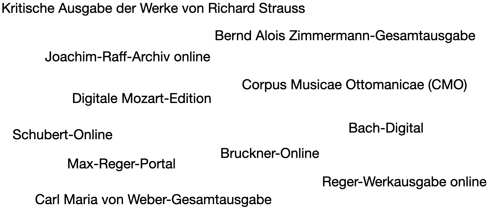

<!--
author:   Dennis Ried
email:    dennis.ried@musikwiss.uni-halle.de
version:  1.0.0
language: de
narrator: Deutsch Female
import:   ../liascript-config.md
link:     ../liascript-style.css
link:     https://fonts.googleapis.com/css2?family=Source+Sans+3:ital,wght@0,200..900;1,200..900&display=swap
font:     Source Sans 3
tags:     edition, analog, digital, hybrid
-->

# Online-Portale

---

---
Selbstbezeichnungen von Online-Portalen aus dem musikwissenschaftlichen Kontext

## Definition

{{0}}
*************************
> Es gibt zahlreiche Bezeichnungen für dieses Phänomen, doch unabhängig davon, wie sich diese Erscheinungen im Einzelnen selbst bezeichnen, sind es doch im wesentlichen Datenbanken, verstanden als organisierte Sammlungen von Forschungsdaten, deren Erscheinung den Charakter eines Zugangs zu einer definierten Welt aufweist. Der Begriff „Portal“ bezeichnet ein Tor bzw. einen Eingang und auch der Begriff „Internetportal“ beschreibt, der Wortdefinition im Duden folgend, eine Webseite, „die so angelegt ist, dass man von ihr aus bequem auf eine Vielzahl von Informationen zu einem bestimmten Thema zugreifen kann“[^1]. Darüber hinausgehend spiegelt der Begriff des „Online-Portals“ im derzeitigen Sprachgebrauch der Digital Humanities und der Musikwissenschaft auch die Gesamtheit der Inhalte wider, die hinter der Startseite eines solchen Onlineangebotes zu finden sind.
>
> – Ried, Dennis: *„halb und halb“ – Hybride Edition als Kompromiss?* \[…\], Berlin 2024, S. 271.
*************************

{{1}}
*************************
> Die Funktion einer solchen digitalen Umgebung, die sich hieraus ableiten lässt, ist die einer Schnittstelle, deren Aufgabe es ist, bestimmte Forschungsdaten in eine Form zu bringen, die aus einer Nutzer*innenperspektive heraus rezipiert werden kann. Es handelt sich daher um ein Interface, dessen Aufgabe es ist, Forschungsergebnisse zu kommunizieren.
>
> – Ebd.

*************************

{{2}}
*************************
---

> \[17\] Digitale Editionen sind wissenschaftliche Leistungen. Die an einer digitalen Edition beteiligten Personen und Institutionen übernehmen die wissenschaftliche Verantwortung für Inhalt und Technik und gewährleisten Mindestansprüche der Fachwissenschaften, der digitalen Editorik, des Standes der Technik und der Gestaltung von Benutzungsoberflächen.
>
> – Christiane Fritze/et. al. (Hrsg.): *Manifest für digitale Editionen*, 11. März 2022, https://web.archive.org/web/20220807064311/https://dhd-blog.org/?p=17563.
*************************

## Annäherung

{{0}}
*************************
Diskussion
---

Grundfragen, die sich im Hinblick auf Editionen im Digitalen stellen:

- Was gehört zur Edition?
- Wo beginnt die Edition?
- Wo hört die Edition auf?
*************************

{{1}}
*************************
---

Arbeitsauftrag
---

- Öffnen Sie das Online-Portal von [Henze-Digital](https://henze-digital.zenmem.de/de/Index)
- Erkunden Sie die entsprechende Seite für 15–20 Minuten
- Notieren Sie dabei alles, was Ihnen auffällt
*************************

[^1]: Cornelsen Verlag GmbH (Hrsg.): Artikel: *Internetportal* (duden.de), 2022, https://web.archive.org/web/20221010101115/https://www.duden.de/rechtschreibung/Internetportal.

## Sortierung von Daten

Die Frage der Sortierung wird immer dann relevant, wenn Inhalte dargestellt werden sollen – unabhängig davon in welchem Medium die Darstellung erfolgen soll.

### Briefe
Datumsangaben

### Werke

### Personen

Personen können nach ihrem Nachname sortiert werden. Probleme entstehen dann, wenn kein Nachname verfügbar ist (z. B. bei Adligen) oder mehrere Nachnamen in zeitlicher Abhängigkeit existieren.

Beispiel: Cosima Liszt
---
GND: Cosima Wagner, https://d-nb.info/gnd/118628232
JRA: Cosima von Bülow (geb. Liszt), https://raff-archiv.ch/C00115

Korrekt wäre **Cosima**…

| Status   | Nachname   | Periode   | Bemerkung |
| :--------- | :--------- | :--------- | :--------- |
| geborene     | *de Flavigny*     | 24.12.1837–1844 | ihre Mutter hieß Marie *d'Agoult* |
| anerkannte | *Liszt* | 1844–1857 | nach Annerkennung der Vaterschaft |
| verheiratete | *von Bülow* | 18.08.1857–18.07.1870 |  |
| geschiedene | *von Bülow* | 18.07.1870–25.08.1870 | Zeitraum nach der Scheidung |
| verheiratete | *Wagner* | 25.08.1870–01.04.1930 |  |

Als Isolde (Cosimas Tochter mit Richard Wagner) geboren wurde, war sie noch mit Hans von Bülow verheiratet. Daher ist der Geburtsnahme der Tochter "Isolde Freifrau von Bülow"; ihr eigener zu diesem Zeitpunkt "Cosima Freifrau von Bülow".

---

Personenregister von *JRA.digital*
---

<iframe style="width:100%; min-height: 750px;" src="https://raff-archiv.ch/registryPersonsInitial.html" title="JRA.digital Personenregister"></iframe>

## Literatur
- Fritze, Christiane/et. al. (Hrsg.): Manifest für digitale Editionen, 11. März 2022, https://web.archive.org/web/20220807064311/https://dhd-blog.org/?p=17563. Das Manifest wurde im Rahmen eines Workshops während der DHd2022 erarbeitet und veröffentlicht. Die mehr als 40 Erstunterzeichner sind auch Autoren des Manifestes.
- Ried, Dennis: *"halb und halb" – Hybride Edition als Kompromiss? Eine Studie zu Methodik, Möglichkeiten und Grenzen in der hybriden Musikedition am Beispiel der Edition von Ludwig Baumanns "Kantate. Den Gefallenen zum Gedächtnis, den Trauernden zum Trost"*, Berlin 2024, DOI: [10.30819/5730](https://doi.org/10.30819/5730)
